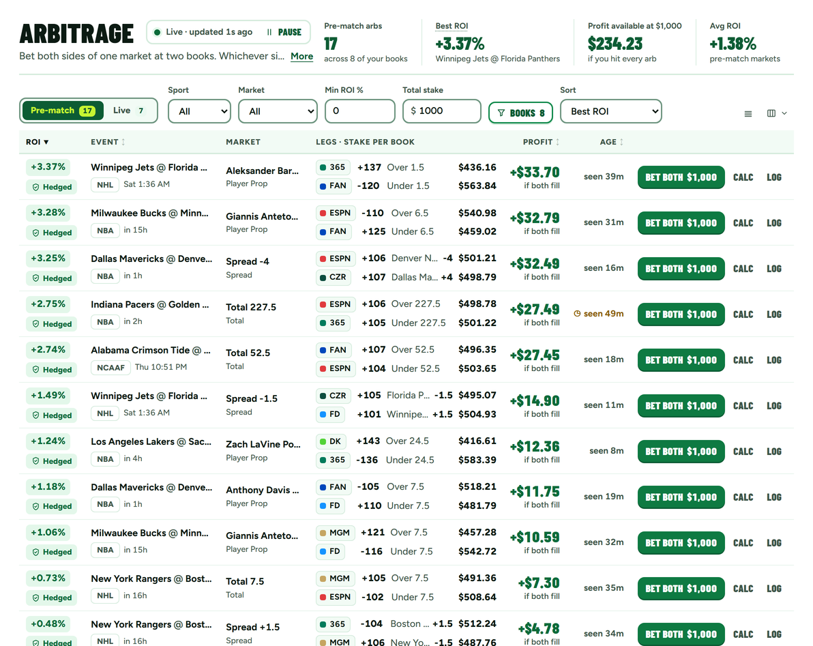

# BetFriend landing page: design system (BF097 style)

Static HTML page selling the whole BetFriend product: every tool plus the plans. The look is BF097, the `/bf` page in
`oddsjam-lp/app/bf/` (`landing.css`, `bf.css`, `page.tsx`). Where this spec and BF097 disagree, BF097 wins. The product
showcase borrows OddsJam's pattern: real product screens in a browser-window frame, sitting on the brand ground.

Everything below uses the `bf2-` class prefix from BF097, so the CSS can be lifted almost one to one.

---

## 0. Hard rules (banned)

From Max's brief (`oddsjam-lp/docs/bf/design-notes.md`). Never ship any of these:

- Cream or off-white **page** grounds. The page is `#FFFFFF`. (The product screenshots have their own app ground
  inside them; that's fine inside a framed screenshot. Never let that colour bleed into a section.)
- Italic accent words in headlines. No italics in Barlow at all.
- Numbered "01 / 02 / 03" section or step labels. Steps use green check-mark bullets.
- Monospace labels (eyebrows, tags, kickers). Figtree only.
- Pill-shaped buttons. Buttons are 10px radius. Small tags are 6 to 8px radius, never fully round.
- Red on any button. Flag red `#E5484D` appears only on Coach Mate's challenge flag.
- "BetFriend" inside an uppercase Barlow headline: the capital F disappears. Keep the name in the logo, body and FAQ.

---

## 1. Tokens

Copy exactly. These come from `landing.css` (`.bf2`) and the brand guide.

```css
:root {
  --g: #118A4C;          /* I4 ground: hero + final CTA band, green buttons on white, logo tile, check bullets */
  --deep: #0C5C34;       /* I4 deep: footer, links/highlights on white, figures, focus ring on white */
  --mint: #B9F5D2;       /* I4 mint: calm panel ("No tips. Just the math"), plan "on" offset shadow */
  --pitch: #14864B;      /* G6 pitch: second green band ("Price gaps close fast") */
  --pitch-deep: #0C4F2D; /* G6 deep: tiles inside the pitch band, text on lime */
  --lime: #C6F432;       /* the one loud accent: primary button on green, "Friend" on green, titles on deep green */
  --ink: #0B1A12;        /* body text, Mate's headset */
  --muted: #3E5649;      /* secondary text on white and mint */
  --line: #D5EBDD;       /* card borders, rules, FAQ dividers */
  --soft: #EAF9F0;       /* slip leg rows, small tags, light pills */

  /* used literally in BF097, keep them */
  --lime-shadow: #7FA012;  /* hard shadow under the lime button */
  --on-green-soft: #E4F5EB;/* terms/kicker text on --g */
  --on-green-mute: #D3EEDF;/* footer text, ad source line */
  --on-pitch-mute: #D6EFE1;/* body text inside .bf2-catch on the pitch band */
  --flag: #E5484D;         /* Coach Mate's flag ONLY */

  --f-head: "Barlow Condensed", "Arial Narrow", sans-serif;
  --f-body: "Figtree", system-ui, sans-serif;
}
```

**Contrast rules (brand guide):** white on `--g` is 4.4:1, so on `--g` use white only for large or bold text (headlines,
buttons, 17px+ weight 600+). Lime text goes only on `--g` (large text) or on `--pitch-deep` / `--deep`. On white, body is
`--ink`, secondary is `--muted`; figures and links are `--deep`.

---

## 2. Fonts

```html
<link rel="preconnect" href="https://fonts.googleapis.com">
<link rel="preconnect" href="https://fonts.gstatic.com" crossorigin>
<link rel="stylesheet" href="https://fonts.googleapis.com/css2?family=Barlow+Condensed:wght@800;900&family=Figtree:wght@500;600;700;800;900&display=swap">
```

- **Barlow Condensed 900, uppercase:** h1, h2, h3, buttons, prices, stat figures, FAQ `+`. Never italic.
  `line-height: .95` (h1 `.9`), `letter-spacing: .005em` (buttons `.01em`).
- **Figtree 500 to 900:** everything else. Body is 500. Labels/emphasis 700 to 800. Wordmark 900.

---

## 3. Type scale

| Role | Mobile (390) | Desktop (≥980) | CSS |
|---|---|---|---|
| H1 hero | 52px | 96px | `font: 900 clamp(50px, 13.4vw, 96px)/.9 var(--f-head); max-width: 12ch` (a longer headline: `clamp(40px, 10.6vw, 76px)`, `max-width: 15ch`) |
| H2 section | 36px | 60px | `clamp(36px, 5.2vw, 60px)/.95` |
| H3 card/plan | 26px | 26px | `26px/1` |
| Price | 48px | 48px | Barlow 900, `--deep` |
| Stat figure | 26px | 26px | Barlow 900 uppercase, `--deep` |
| Button | 22px | 22px | Barlow 900 uppercase |
| Body | 17px/1.5 | 17px/1.5 | Figtree 500 |
| Sub / lead | 18px | 18px (lead on hero 17px, proof 20px) | `--muted` on white |
| Strong sub on band | 20px / 800 | same | lime on `--pitch` |
| FAQ question | 19px / 800 | same | |
| Small / terms | 13 to 15px / 600 | same | under every button |
| Tag | 12px / 800 | same | `--soft` bg, 6px radius |

Use `font-variant-numeric: tabular-nums` on odds, stakes, prices. Keep "2-3%" together with a non-breaking hyphen
(`2&#8209;3%`).

---

## 4. Spacing and layout

- Container: `max-width: 1180px; padding-inline: 16px` (32px at ≥980).
- Section: `padding-block: 48px; gap: 18px` (80px / 22px at ≥980). Display grid.
- Breakpoints: **700px** (facts go 4-up; cards/plans 3-up), **980px** (two-column hero/how/band, sticky bar off).
- Two-column splits at ≥980: hero `1.1fr .9fr`, gap 64px; how-it-works `1fr 1fr`; band `1.1fr .9fr`.
- Radii: buttons 10, slip 14, slip rows 10, cards/plans 16, hero art panel 28, tags 6 to 8, logo tile 15/64.
- Shadows are **hard offsets, no blur**: buttons `0 4px 0`, plan-on `6px 6px 0 var(--mint)`, hero bubble
  `6px 6px 0 var(--pitch-deep)`, phone proof bubble `4px 4px 0 var(--deep)`. Only the screenshot frame gets a soft shadow.

---

## 5. Section rhythm

BF097's order of grounds, extended for an all-tools page. Never put two green bands back to back; white sections sit
between them.

| # | Section | Ground | Notes |
|---|---|---|---|
| 1 | Top bar + hero | `--g` full bleed | Logo (on-green tone) left, `21+` badge right. Copy left, art right (desktop). For this page, the hero art can be the framed `app-daily` screenshot with Coach Mate overlapping its corner, OddsJam-style. |
| 2 | Facts / stats row | white | 4 stats, ruled bottom border. |
| 3 | Product showcase: tools | white | Tab row or grid of tool cards, each with a framed screenshot. |
| 4 | How it works (worked example) | white | Steps + bet slip + mid CTA. |
| 5 | "Gaps close fast" style band | `--pitch` | Lime strong sub, `.bf2-catch` tile with Coach Mate (flag). |
| 6 | More tools / three ways | white | Way cards with slips. |
| 7 | Honesty panel | `--mint` | Coach Mate (film) on a green tile + check list. |
| 8 | Plans | white | 3 to 4 plan cards; the recommended one gets `.on`. |
| 9 | FAQ | white | Ruled accordion. |
| 10 | Final CTA | `--g` | H2, body, lime button, terms. `id="signup"` (the sticky bar hides here). |
| 11 | Footer | `--deep` | Logo (on-green tone), 21+/gambling help line, legal. |

---

## 6. Components (copy-ready)

### 6.1 Base

```css
*, *::before, *::after { box-sizing: border-box; }
html { -webkit-text-size-adjust: 100%; }
body { margin: 0; background: #FFFFFF; color: var(--ink); font: 500 17px/1.5 var(--f-body); }
h1, h2, h3 { font-family: var(--f-head); font-weight: 900; text-transform: uppercase; letter-spacing: .005em; line-height: .95; margin: 0; }
h2 { font-size: clamp(36px, 5.2vw, 60px); }
h3 { font-size: 26px; line-height: 1; }
p { margin: 0; }
img { max-width: 100%; height: auto; display: block; }
.bf2-wrap { width: 100%; max-width: 1180px; margin: 0 auto; padding-inline: 16px; }
.bf2-sec { padding-block: 48px; display: grid; gap: 18px; }
.bf2-sub { font-size: 18px; color: var(--muted); max-width: 60ch; }
@media (min-width: 980px) {
  .bf2-wrap { padding-inline: 32px; }
  .bf2-sec { padding-block: 80px; gap: 22px; }
}
```

### 6.2 Focus rings (keep exactly)

Deep green on white, lime on any green ground. Never the browser blue.

```css
:focus-visible { outline: 3px solid var(--deep); outline-offset: 3px; }
.bf2-hero-band :focus-visible, .bf2-band :focus-visible, .bf2-final :focus-visible, .bf2-foot :focus-visible { outline-color: var(--lime); }
```

### 6.3 Buttons

Square-ish (10px), Barlow uppercase, hard offset shadow, press moves down 2px. Min height 56px (52 in the sticky bar).
Every button has its trial/terms line directly under it.

```css
.bf2-cta {
  display: inline-flex; align-items: center; justify-content: center; min-height: 56px; padding: 12px 22px; border-radius: 10px;
  font: 900 22px/1 var(--f-head); text-transform: uppercase; letter-spacing: .01em;
  text-decoration: none; text-align: center; border: 0; cursor: pointer; transition: transform .08s, box-shadow .08s;
}
.bf2-cta:active { transform: translateY(2px); }
/* Primary on green grounds */
.bf2-cta-lime { background: var(--lime); color: var(--pitch-deep); box-shadow: 0 4px 0 #7FA012; }
.bf2-cta-lime:active { box-shadow: 0 2px 0 #7FA012; }
/* Primary on white */
.bf2-cta-green { background: var(--g); color: #FFFFFF; box-shadow: 0 4px 0 var(--deep); }
.bf2-cta-green:active { box-shadow: 0 2px 0 var(--deep); }
/* Secondary on white (non-selected plan cards) */
.bf2-cta-outline { background: #FFFFFF; color: var(--deep); border: 2px solid var(--g); box-shadow: 0 4px 0 var(--line); }
@media (hover: hover) { .bf2-cta:hover { filter: brightness(1.04); } }
```

```html
<div class="bf2-mid">
  <a class="bf2-cta bf2-cta-green" href="#plans">See today's price gaps</a>
  <p class="bf2-mid-terms">Free for 60 minutes, card required, then $199.99/month unless you cancel. $0 today.</p>
</div>
```
```css
.bf2-mid { display: grid; gap: 8px; justify-items: stretch; max-width: 420px; margin-top: 8px; }
.bf2-mid-terms { font-size: 13px; font-weight: 600; color: var(--muted); }
```

### 6.4 Logo lockup

Prefer the inline HTML lockup (real Figtree text) over `img/logo.svg`, because an SVG loaded via `` can't use the
web font. `img/logo.svg` / `img/logo-on-green.svg` are the fallback (OG images, email); they set Figtree 900 with a system
fallback and a fixed `textLength`, so they always fit.

```html
<a class="bf-logo bf-logo-dark" href="/" aria-label="BetFriend home">
  
  <span class="bf-word" aria-hidden="true">Bet<span>Friend</span></span>
</a>
```
```css
.bf-logo { display: inline-flex; align-items: center; gap: 10px; line-height: 1; text-decoration: none; }
.bf-word { font: 900 26px/1 var(--f-body); letter-spacing: -0.035em; color: var(--ink); } /* size = tile x 0.72 */
.bf-word span { color: var(--g); }
.bf-logo-dark .bf-word { color: #FFFFFF; }
.bf-logo-dark .bf-word span { color: var(--lime); }
```
Tile colour: `mate-face.svg` (`#118A4C`) on white; `mate-face-deep.svg` (`#0C5C34`) on `--g` or `--deep` grounds.
Clear space: half the tile width. Below 24px tile, drop the wordmark.

### 6.5 Hero band

```html
<div class="bf2-hero-band">
  <header class="bf2-wrap bf2-top"> [logo, dark tone] <span class="bf2-age">21+</span></header>
  <section class="bf2-wrap bf2-hero">
    <div class="bf2-hero-copy">
      <p class="bf2-kicker">BetFriend: betting software for US sports bettors</p>
      <h1>…</h1>
      <div class="bf2-proof-row">
        
        <p class="bf2-proof">Example: $487 across two books, +$42 to +$44 whichever side hits.</p>
      </div>
      <a id="hero-cta" class="bf2-cta bf2-cta-lime" href="#plans">…</a>
      <p class="bf2-terms">…</p>
      <p class="bf2-lead">…</p>
    </div>
    <div class="bf2-hero-art" aria-hidden="true"> [framed screenshot or pitch panel + Coach Mate, see 6.7] </div>
  </section>
</div>
```
```css
.bf2-hero-band { background: var(--g); color: #FFFFFF; }
.bf2-top { display: flex; align-items: center; justify-content: space-between; padding-block: 12px 4px; }
.bf2-age { font-size: 14px; font-weight: 800; border: 2px solid rgba(255,255,255,.55); border-radius: 8px; padding: 2px 8px; }
.bf2-hero { display: grid; gap: 32px; padding-block: 14px 36px; }
.bf2-hero-copy { display: grid; gap: 12px; justify-items: start; align-content: start; }
.bf2-kicker { font-size: 16px; font-weight: 800; color: #E4F5EB; }
.bf2-hero h1 { font-size: clamp(50px, 13.4vw, 96px); line-height: .9; color: #FFFFFF; max-width: 12ch; }
.bf2-proof-row { display: flex; align-items: center; gap: 12px; }
.bf2-proof-mate { width: 58px; flex: none; }
.bf2-proof { position: relative; font-size: 17px; font-weight: 700; line-height: 1.35; max-width: 34ch; background: #FFFFFF; color: var(--ink); border-radius: 16px; padding: 10px 14px; box-shadow: 4px 4px 0 var(--deep); }
.bf2-proof::before { content: ""; position: absolute; left: -9px; top: 50%; margin-top: -8px; border: 8px solid transparent; border-right: 10px solid #FFFFFF; border-left: 0; }
.bf2-hero .bf2-cta { width: 100%; max-width: 420px; margin-top: 4px; }
.bf2-terms { font-size: 14px; font-weight: 600; color: #E4F5EB; max-width: 46ch; }
.bf2-lead { font-size: 17px; color: #FFFFFF; max-width: 46ch; margin-top: 8px; }
.bf2-hero-art { display: none; position: relative; padding-bottom: 48px; }
@media (min-width: 980px) {
  .bf2-top { padding-block: 22px 0; }
  .bf2-hero { grid-template-columns: minmax(0,1.1fr) minmax(0,.9fr); gap: 64px; align-items: center; padding-block: 48px 80px; }
  .bf2-hero-art { display: block; }
  .bf2-proof-mate { display: none; }
  .bf2-proof { font-size: 20px; background: none; color: #FFFFFF; box-shadow: none; border-radius: 0; padding: 0 0 0 12px; border-left: 4px solid var(--lime); }
  .bf2-proof::before { display: none; }
}
```

BF097's pitch panel (desktop hero art) if you use Coach Mate instead of a screenshot:

```html
<div class="bf2-panel">
  <svg class="bf2-pitch" viewBox="0 0 400 340" preserveAspectRatio="xMidYMid slice"><g fill="none" stroke="currentColor" stroke-width="2.5">
    <rect x="20" y="20" width="360" height="300" rx="6"/><path d="M200 20 V320"/><circle cx="200" cy="170" r="58"/>
    <rect x="20" y="105" width="56" height="130"/><rect x="324" y="105" width="56" height="130"/></g></svg>
  
</div>
<div class="bf2-bubble"><span>Player prop · Made threes</span><b>+$42 to +$44 on $487, whichever side hits</b></div>
```
```css
.bf2-panel { position: relative; background: var(--deep); border-radius: 28px; aspect-ratio: 1 / .82; display: grid; place-items: center; overflow: hidden; }
.bf2-pitch { position: absolute; inset: 0; width: 100%; height: 100%; color: rgba(255,255,255,.14); }
.bf2-hero-mate { position: relative; width: 80%; }
.bf2-bubble { position: absolute; left: -24px; right: 14%; bottom: 0; background: #FFFFFF; color: var(--ink); border-radius: 20px; padding: 14px 18px; display: grid; gap: 2px; box-shadow: 6px 6px 0 var(--pitch-deep); }
.bf2-bubble span { font-size: 13px; font-weight: 800; color: var(--deep); }
.bf2-bubble b { font-size: 19px; line-height: 1.25; }
```

### 6.6 Stats row (facts)

```html
<section class="bf2-facts bf2-wrap" aria-label="The numbers">
  <div><b>Most price gaps pay 2&#8209;3%</b><span>That's $2 to $3 per $100 staked…</span></div>
  … x4
</section>
```
```css
.bf2-facts { display: grid; grid-template-columns: 1fr 1fr; gap: 20px 16px; padding-block: 32px; border-bottom: 2px solid var(--line); }
.bf2-facts div { display: grid; gap: 4px; align-content: start; }
.bf2-facts b { font: 900 26px/1 var(--f-head); text-transform: uppercase; color: var(--deep); }
.bf2-facts span { font-size: 14px; color: var(--muted); line-height: 1.4; }
@media (min-width: 700px) { .bf2-facts { grid-template-columns: repeat(4, minmax(0,1fr)); } }
```

### 6.7 Product screenshot frame (new, OddsJam pattern)

OddsJam shows its real tool in a dark app window overlapping the hero. Our version: the light screenshot in a white
browser frame with a deep-green top strip and three dots (neutral, not macOS red/yellow/green: no red). Radius 14,
2px `--line` border on white sections, no border on green bands. This is the only place a soft shadow is allowed.

```html
<figure class="bf2-shot">
  <div class="bf2-shot-bar" aria-hidden="true"><i></i><i></i><i></i><span>Arbitrage</span></div>
  <picture>
    <source type="image/webp" srcset="img/app-arbitrage.webp 1x, img/app-arbitrage@2x.webp 2x">
    
  </picture>
</figure>
```
```css
.bf2-shot { margin: 0; background: #FFFFFF; border: 2px solid var(--line); border-radius: 14px; overflow: hidden; box-shadow: 0 18px 40px -18px rgba(11,26,18,.35); }
.bf2-hero-band .bf2-shot, .bf2-band .bf2-shot { border: 0; box-shadow: 8px 8px 0 var(--deep); } /* on green: hard shadow like the bubble */
.bf2-shot-bar { display: flex; align-items: center; gap: 6px; height: 30px; padding: 0 12px; background: var(--deep); color: #D3EEDF; font-size: 12px; font-weight: 700; }
.bf2-shot-bar i { width: 9px; height: 9px; border-radius: 50%; background: rgba(255,255,255,.35); }
.bf2-shot-bar span { margin-left: 8px; }
.bf2-shot img { width: 100%; aspect-ratio: 1192 / 947; object-fit: cover; object-position: top left; }
/* On phones, show the left/top of wide tables instead of shrinking them to unreadable */
@media (max-width: 699px) { .bf2-shot img { aspect-ratio: 4 / 3.4; } }
```

For a hero overlap (OddsJam-style), put the frame at the bottom of the hero band with a negative bottom margin
(`margin-bottom: -120px`) and give the next white section `padding-top: 150px` on desktop. Coach Mate
(`img/coach-mate-gameplan.svg`, ~110px) can perch on the frame's top-right corner (`position:absolute; top:-56px; right:-20px`).

**Tool tabs** (showcase several screens in one slot, no JS framework needed): a row of buttons styled as square-ish
tabs, `border-radius: 8px`, inactive `background: var(--soft); color: var(--deep)`, active `background: var(--deep);
color: var(--lime)`, Barlow 900 16px uppercase, letter-spacing .04em (BF097's `.bf2-pill`, which despite the name is 8px
radius, not a pill). Use `role="tablist"`/`aria-selected`, swap the `<picture>`. On phones the tab row scrolls
horizontally (`overflow-x: auto; scrollbar-width: none`) inside the wrap; the page itself must not scroll sideways.

### 6.8 Bet slip (worked example) — keep exactly

```html
<figure class="bf2-slip">
  <figcaption>Player prop · Made threes · Over/Under 0.5 <span>Example</span></figcaption>
  <ul>
    <li><span class="bf2-leg"><b>Over 0.5</b><small>Book A</small></span><span class="bf2-odds">+183</span><span class="bf2-stake">$187</span></li>
    <li><span class="bf2-leg"><b>Under 0.5</b><small>Book B</small></span><span class="bf2-odds">−130</span><span class="bf2-stake">$300</span></li>
  </ul>
  <p class="bf2-result">+$42 to +$44 on $487, whichever side hits</p>
  <p class="bf2-math">$187 at +183 pays back $529.21; $300 at −130 pays back $530.77…</p>
</figure>
```
```css
.bf2-slip { margin: 0; background: #FFFFFF; color: var(--ink); border: 2px solid var(--line); border-radius: 14px; padding: 14px; display: grid; gap: 10px; }
.bf2-slip figcaption { display: flex; justify-content: space-between; gap: 10px; font-size: 14px; font-weight: 800; color: var(--deep); }
.bf2-slip figcaption span { flex: none; align-self: flex-start; font-size: 12px; font-weight: 800; color: var(--muted); background: var(--soft); border-radius: 6px; padding: 1px 7px; }
.bf2-slip ul { list-style: none; margin: 0; padding: 0; display: grid; gap: 6px; }
.bf2-slip li { display: grid; grid-template-columns: 1fr auto auto; gap: 12px; align-items: center; padding: 10px 12px; background: var(--soft); border-radius: 10px; }
.bf2-leg b { display: block; font-size: 16px; line-height: 1.2; }
.bf2-leg small { font-size: 13px; color: var(--muted); }
.bf2-odds { font-weight: 800; font-size: 17px; font-variant-numeric: tabular-nums; }
.bf2-stake { font-weight: 800; font-size: 15px; min-width: 52px; text-align: right; font-variant-numeric: tabular-nums; }
.bf2-result { font-size: 18px; font-weight: 900; color: var(--deep); }
.bf2-math { font-size: 14px; color: var(--muted); line-height: 1.45; }
```

### 6.9 Check-mark lists (steps, honesty, plan features) — no numbers

```css
.bf2-checks { list-style: none; margin: 0; padding: 0; display: grid; gap: 10px; font-weight: 600; }
.bf2-checks li { display: grid; grid-template-columns: 20px 1fr; gap: 8px; }
.bf2-checks li::before { content: ""; width: 11px; height: 6px; margin-top: 8px; border-left: 3px solid var(--g); border-bottom: 3px solid var(--g); transform: rotate(-45deg); }
/* Steps variant: 4px green rule on top */
.bf2-steps { border-top: 4px solid var(--g); padding-top: 16px; gap: 12px; }
/* On green grounds swap the tick colour to lime */
.bf2-band .bf2-checks li::before, .bf2-final .bf2-checks li::before { border-color: var(--lime); }
```

### 6.10 Tool / way cards

Top-ruled, not boxed: `border-top: 4px solid var(--g); padding-top: 16px`. H3, muted description, optional slip or
framed screenshot, then a `dl` of facts.

```css
.bf2-ways { display: grid; gap: 20px; margin-top: 8px; }
.bf2-way { display: grid; gap: 12px; align-content: start; border-top: 4px solid var(--g); padding-top: 16px; }
.bf2-way > p { color: var(--muted); }
.bf2-way dl { margin: 0; display: grid; grid-template-columns: auto 1fr; gap: 6px 12px; font-size: 15px; }
.bf2-way dt { font-weight: 800; }
.bf2-way dd { margin: 0; color: var(--muted); }
@media (min-width: 700px) { .bf2-ways { grid-template-columns: repeat(3, minmax(0,1fr)); } }
/* 12 tools: 2-up at 700, 4-up at 980 (BF097's .bf2-oj-cards) */
.bf2-tools { display: grid; gap: 16px; }
@media (min-width: 700px) { .bf2-tools { grid-template-columns: repeat(2, minmax(0,1fr)); gap: 24px; } }
@media (min-width: 980px) { .bf2-tools { grid-template-columns: repeat(4, minmax(0,1fr)); } }
```

Tool-to-plan tag (small, square-ish, light): `.bf2-tag { display:inline-block; font-size:12px; font-weight:800;
color: var(--deep); background: var(--soft); border-radius: 6px; padding: 2px 8px; }`.

### 6.11 Pitch band + catch tile

```html
<section class="bf2-band"><div class="bf2-sec bf2-wrap bf2-fast">
  <div><h2>Price gaps close fast.</h2><p class="bf2-sub-strong">You have to see them while they're open.</p><p>…</p></div>
  <div class="bf2-catch"><h3>The catch: sportsbooks limit winners.</h3><p>…</p></div>
</div></section>
```
```css
.bf2-band { background: var(--pitch); color: #FFFFFF; }
.bf2-fast { gap: 24px; }
.bf2-fast > div:first-child { display: grid; gap: 12px; }
.bf2-sub-strong { font-size: 20px; font-weight: 800; color: var(--lime); }
.bf2-catch { position: relative; background: var(--pitch-deep); border-radius: 16px; padding: 20px; display: grid; gap: 10px; }
.bf2-catch h3 { color: var(--lime); padding-right: 64px; }
.bf2-catch p { color: #D6EFE1; }
.bf2-catch-face { position: absolute; right: 12px; top: -22px; width: 70px; }
@media (min-width: 980px) { .bf2-fast { grid-template-columns: minmax(0,1.1fr) minmax(0,.9fr); gap: 64px; align-items: center; } }
```

### 6.12 Honesty panel (mint)

```css
.bf2-mint { background: var(--mint); }
.bf2-honest { display: grid; gap: 18px; }
.bf2-honest-face { width: 88px; background: var(--g); border-radius: 20px; padding: 8px; } /* img/coach-mate-film.svg */
.bf2-honest > div { display: grid; gap: 14px; }
@media (min-width: 980px) { .bf2-honest { grid-template-columns: 120px 1fr; gap: 32px; align-items: start; } .bf2-honest-face { width: 120px; } }
```

### 6.13 Plan cards — keep exactly

```html
<article class="bf2-plan on">
  <h3>Pre-Match Arbitrage</h3>
  <p class="bf2-plan-for">Bet both sides before the game starts.</p>
  <p class="bf2-price">$199.99<small>/month</small></p>
  <ul class="bf2-checks"><li>…</li></ul>
  <p class="bf2-needs">3+ sportsbooks · about $2,000 · 30 to 60 minutes a day</p>
  <a class="bf2-cta bf2-cta-green" href="…">Start with this plan</a>   <!-- non-selected cards: bf2-cta-outline -->
  <p class="bf2-plan-terms">Free for 60 minutes, card required, then $199.99/month…</p>
</article>
```
```css
.bf2-plans { display: grid; gap: 16px; margin-top: 8px; }
.bf2-plan { display: grid; gap: 10px; align-content: start; border: 2px solid var(--line); border-radius: 16px; padding: 20px; background: #FFFFFF; }
.bf2-plan.on { border-color: var(--g); box-shadow: 6px 6px 0 var(--mint); }
.bf2-plan-for { font-weight: 700; color: var(--muted); }
.bf2-price { font: 900 48px/1 var(--f-head); color: var(--deep); }
.bf2-price small { font: 700 16px var(--f-body); color: var(--muted); margin-left: 4px; }
.bf2-plan ul { font-size: 15px; gap: 8px; }
.bf2-needs { font-size: 14px; font-weight: 700; padding-top: 10px; border-top: 1px solid var(--line); }
.bf2-plan .bf2-cta { margin-top: 6px; }
.bf2-plan-terms { font-size: 14px; font-weight: 600; color: var(--muted); }
@media (min-width: 700px) { .bf2-plans { grid-template-columns: repeat(3, minmax(0,1fr)); } }
/* 4 plans (e.g. adding All-Access): 2-up at 700, 4-up at 1100 */
.bf2-plans.four { }
@media (min-width: 700px) { .bf2-plans.four { grid-template-columns: repeat(2, minmax(0,1fr)); } }
@media (min-width: 1100px) { .bf2-plans.four { grid-template-columns: repeat(4, minmax(0,1fr)); } }
```
A "best value" marker, if needed: a small `.bf2-tag` styled `background: var(--deep); color: var(--lime)` above the H3.
Not a ribbon, not a pill.

### 6.14 FAQ accordion — keep exactly

Native `<details>`, first one open, ruled rows, Barlow `+` turning into `−`.

```html
<section class="bf2-sec bf2-wrap bf2-faq">
  <h2>Questions</h2>
  <details open><summary>Will I get limited?</summary><p>…</p></details>
  <details><summary>How much money do I need?</summary><p>…</p></details>
</section>
```
```css
.bf2-faq { gap: 0; }
.bf2-faq h2 { margin-bottom: 20px; }
.bf2-faq details { border-bottom: 2px solid var(--line); padding: 16px 0; max-width: 800px; }
.bf2-faq details:first-of-type { border-top: 2px solid var(--line); }
.bf2-faq summary { list-style: none; min-height: 44px; display: flex; justify-content: space-between; align-items: center; gap: 16px; font-size: 19px; font-weight: 800; cursor: pointer; }
.bf2-faq summary::-webkit-details-marker { display: none; }
.bf2-faq summary::after { content: "+"; flex: none; font: 900 30px/1 var(--f-head); color: var(--g); }
.bf2-faq details[open] summary::after { content: "\2212"; }
.bf2-faq details p { margin-top: 10px; color: var(--muted); max-width: 70ch; }
```

### 6.15 Final CTA + footer

```css
.bf2-final { background: var(--g); color: #FFFFFF; }
.bf2-final .bf2-sec { justify-items: start; }
.bf2-final p { max-width: 56ch; font-size: 18px; }
.bf2-final .bf2-cta { width: 100%; max-width: 420px; }
.bf2-final .bf2-terms { font-size: 14px; }
.bf2-foot { background: var(--deep); color: #D3EEDF; padding-block: 28px 110px; font-size: 14px; } /* 110px clears the sticky bar */
.bf2-foot .bf2-wrap { display: grid; gap: 8px; }
.bf2-foot a { color: #FFFFFF; }
@media (min-width: 980px) { .bf2-foot { padding-bottom: 40px; } }
```
Footer must carry: "21+ only. Gambling problem? Call 1-800-GAMBLER.", "BetFriend is betting software, not a sportsbook.
It doesn't take bets or hold your money.", "Example prices are illustrative. Real prices move, and no bet is a sure thing."

### 6.16 Sticky mobile CTA bar — keep exactly

Phones only (<980px). Appears once `#hero-cta` has scrolled off; hides while any other mid-page or plan button is on
screen, and once `#signup` (final CTA) is in view, so there are never two buttons visible at once.

```html
<div class="bf2-sticky" data-show="false" aria-hidden="true">
  <a class="bf2-cta bf2-cta-green" href="#plans" tabindex="-1">See today's price gaps</a>
  <p class="bf2-sticky-terms">Free for 60 minutes, card required. $0 today.</p>
</div>
```
```css
.bf2-sticky { position: fixed; left: 0; right: 0; bottom: 0; z-index: 20; padding: 10px 16px calc(10px + env(safe-area-inset-bottom, 0px)); background: rgba(255,255,255,.96); border-top: 1px solid var(--line); transform: translateY(110%); transition: transform .2s ease; }
.bf2-sticky[data-show="true"] { transform: none; }
.bf2-sticky .bf2-cta { width: 100%; min-height: 52px; }
.bf2-sticky-terms { margin-top: 6px; font-size: 12px; font-weight: 600; line-height: 1.3; color: var(--muted); text-align: center; }
@media (min-width: 980px) { .bf2-sticky { display: none; } }
@media (prefers-reduced-motion: reduce) { .bf2-sticky { transition: none; } }
```
```js
(() => {
  const bar = document.querySelector('.bf2-sticky'), btn = bar.querySelector('a');
  const hero = document.getElementById('hero-cta'), end = document.getElementById('signup');
  const others = [...document.querySelectorAll('.bf2-mid .bf2-cta, .bf2-plan .bf2-cta')];
  const vis = el => { const r = el.getBoundingClientRect(); return r.bottom > 0 && r.top < innerHeight - 110; };
  const update = () => {
    const show = hero.getBoundingClientRect().bottom < 0 && end.getBoundingClientRect().top > innerHeight && !others.some(vis);
    bar.dataset.show = show; bar.setAttribute('aria-hidden', !show); btn.tabIndex = show ? 0 : -1;
  };
  addEventListener('scroll', update, { passive: true }); addEventListener('resize', update); update();
})();
```

---

## 7. Coach Mate usage

Pure-SVG ports of `oddsjam-lp/app/coach/CoachMate.tsx`, plain kit (headset + eye black, no country cap). Use as
`` (decorative) unless he's the only carrier of meaning.

| File | Mood | Where (as in BF097) |
|---|---|---|
| `img/coach-mate.svg` | gameplan + clipboard prop, 100×76 viewBox | Desktop hero art on the pitch panel |
| `img/coach-mate-gameplan.svg` | wink + check smile | Phone hero, next to the proof bubble (58px); perched on a screenshot frame |
| `img/coach-mate-flag.svg` | raised brow + red flag | "The catch" tile on the pitch band (70px) |
| `img/coach-mate-film.svg` | studying, dot mouth | Honesty panel on a green tile (88 / 120px) |
| `img/coach-mate-touchdown.svg` | big grin | Final CTA or a "you're in" moment; use sparingly |
| `img/mate-face.svg` / `mate-face-deep.svg` | logo tile face, 64×64 | Logo tile on white / on green; favicon (≥32px) |
| `img/logo.svg` / `logo-on-green.svg` | full lockup | Fallback only; prefer the HTML lockup (6.4) |

Mate always sits on a green ground or a green tile so the white bubble reads. One Mate per screen.

---

## 8. Product screenshots

Recaptured 2026-10-28 after the app UX rebuild with `node qa/landing-shots.mjs` (light theme, 1440 wide at 2x), cropped to
the main content area (sidebar 248px and top bar 58px removed). Each is 1192×947 CSS px. The lens crops in landing.css
(`--x/--y/--w/--h`) point at the top row of arbitrage and sharp-money; re-measure them if those layouts change.

Per route: `img/app-<route>.png` (1x, 235 to 365 KB), `img/app-<route>.webp` (1x, 65 to 96 KB),
`img/app-<route>@2x.webp` (2x, 135 to 205 KB). Use the `<picture>` in 6.7: webp 1x/2x with the PNG as fallback.

| Route | Shows | Good for |
|---|---|---|
| `daily` | Today's Daily Card: green hero with "$1,973 hedged today", ranked moves with Bet both, Your betting, Account health | Hero / "everything in one card" |
| `arbitrage` | Stat tiles + arb table (ROI, legs, stake per book, profit, Calculator) | Arbitrage section |
| `positive-ev` | +EV bet list | +EV section |
| `sharp-money` | Sharp money moves | Signals |
| `bettor-signals` | Pro bettor signals | Signals |
| `ai-picks` | AI sports picks | AI section |
| `live-ai` | Live scores strip, win-probability chart, live bet suggestions | AI / live |
| `prediction-traders` | Prediction-market traders | Prediction markets |
| `pm-markets` | Market list, price chart, order book, trade ticket | Prediction markets |
| `promo-converter` | Promo conversion | Promo section |
| `parlay-builder` | Parlay builder | Parlay section |
| `screen` | Odds screen: books × markets, best price highlighted | "Every book on one screen" |

Notes for the builder:
- The app now uses the landing brand (Barlow titles, light ground, brand greens). That's the real product, so leave the
  screenshots as they are, but always frame them (6.7) so the off-white reads as "inside the app", never as page ground.
- Wide tables (`screen`, `arbitrage`) are cut on the right edge in the source; that's fine inside a frame. On phones
  crop from the top-left (`object-position: top left`) rather than shrinking the whole image.
- All data in them is sample data; the app's top bar showing "Sample data" was cropped out, so keep the footer line
  "Example prices are illustrative."
- Alt text: say what the tool does and what the screen shows, not "screenshot".

---

## 9. Keep exactly from BF097

1. The token values in section 1, the white page and the `--g` hero band.
2. Barlow Condensed 900 uppercase headlines at the clamp sizes above; Figtree 500 body at 17px.
3. 10px-radius buttons with hard `0 4px 0` shadows and the 2px press; lime on green, green on white, outline secondary.
4. The trial/terms line directly under every button.
5. The bet slip, plan card (`.on` with mint offset shadow), FAQ accordion, facts row and sticky bar CSS.
6. Green check-mark bullets instead of numbers.
7. Focus rings: deep green on white, lime on green.
8. Grounds: green hero → white → pitch band → white → mint panel → white plans/FAQ → green final → deep footer.
9. Logo: Figtree 900, −0.035em, "Bet" ink/white, "Friend" green/lime, face on a 15/64-radius tile.
10. `21+` badge top right in the hero.

## 10. Accessibility checklist

- Hit targets ≥44px (buttons 56/52, FAQ summary 44).
- `prefers-reduced-motion`: drop the sticky slide and any tab transitions.
- No horizontal page scroll at 360px; only tab rows scroll inside themselves.
- Inputs (if any) at 16px so iOS doesn't zoom.
- Body text on `--g` must be bold or ≥17px/600 (4.4:1).
